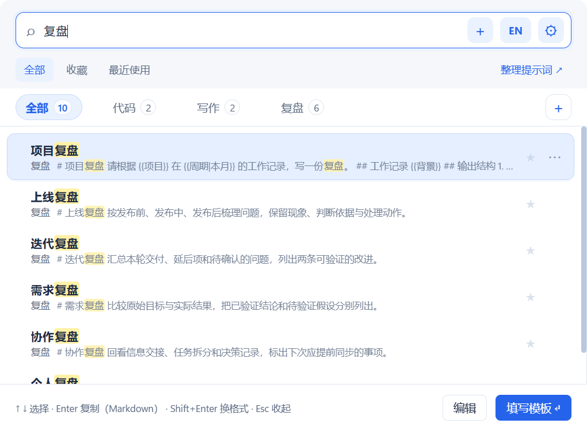

# Prompt Pocket

用全局快捷键唤出桌面提示词库，搜索、填写模板并复制。提示词保存为本地 Markdown 文件，可选手动同步到 GitHub 或坚果云。支持 Windows、macOS 和 Linux。

[下载安装](https://github.com/techdou/prompt-pocket/releases/latest) · [项目网站](https://techdou.github.io/prompt-pocket/) · [反馈问题](https://github.com/techdou/prompt-pocket/issues) · [English](#english)



## 下载安装

从 [最新版 Release](https://github.com/techdou/prompt-pocket/releases/latest) 选择安装包。

| 平台 | 安装包 |
| --- | --- |
| Windows x64 | `.msi` 或 `-setup.exe` |
| macOS Apple Silicon | `.dmg` |
| Linux x64 | `.deb`、`.rpm` 或 `.AppImage` |

## 快速上手

1. 打开 Prompt Pocket。关闭窗口后可通过托盘或全局快捷键再次打开。
2. 在任意应用中按默认快捷键 `Ctrl+Alt+P`，输入标题或正文里的关键词。
3. 用上下方向键选择结果，按 `Enter`。Windows 会尝试粘贴回唤起前的窗口。macOS 和 Linux 写入剪贴板，再手动粘贴。
4. 用 `Shift+Enter` 临时切换复制格式。快捷键冲突时，可从托盘进入设置并改键。

Windows 自动粘贴失败时，应用会发送系统通知，并在下次唤起时补显提示。剪贴板发生变化时，请重新复制提示词。

切换到「整理提示词」可编辑正文、管理分类、收藏、排序和预览 Markdown。删除或覆盖前的内容可以在设置页的恢复记录中找回。

### 模板

在正文里写 `{{变量}}` 或 `{{变量|默认值}}`。调用时填写本次参数，用 `Ctrl+Enter` 应用并复制。原模板不会被改写。

```markdown
请用{{语气|自然}}的语气，面向{{读者}}总结以下内容：

{{原文}}
```

### 数据与同步

| 平台 | 默认提示词目录 |
| --- | --- |
| Windows | `%APPDATA%/com.promptpocket.app/PromptPocket/` |
| macOS | `~/Library/Application Support/com.promptpocket.app/PromptPocket/` |
| Linux | `~/.config/com.promptpocket.app/PromptPocket/` |

提示词按分类目录保存为 `.md` 文件。可用文本编辑器维护，程序兼容 `copyMode` 和 `copy_mode` 两种 frontmatter 键。

同步在设置中手动发起。可以选择 GitHub 存档或坚果云 WebDAV，发生分歧时保留冲突副本。GitHub 令牌和 WebDAV 应用密码由系统凭据库管理，请在应用内配置。

## 本地开发

需要 Node.js 22.6+、Rust 1.89+ 和对应平台的 [Tauri v2 工具链](https://v2.tauri.app/start/prerequisites/)。

```bash
npm ci
npm run tauri:dev
```

| 路径 | 内容 |
| --- | --- |
| `src/` | Svelte 桌面前端 |
| `src-tauri/` | Rust 后端和 Tauri 配置 |
| `tests/` | 浏览器回归测试 |
| `site/` | GitHub Pages 的公开静态资源 |
| `.github/workflows/` | 自动测试、Release 打包和 Pages 发布 |

```bash
npm run verify
cargo test --manifest-path src-tauri/Cargo.toml --locked
npx playwright install --only-shell chromium
npm run test:browser
```

Push 和 Pull Request 会在 GitHub Actions 自动运行桌面测试与打包。版本标签 `vX.Y.Z` 触发 Release，三平台安装包齐备后自动发布。`site/` 的变更推送到 `main` 后发布到 Pages。

## English

Prompt Pocket is a local-first desktop prompt library. Press `Ctrl+Alt+P` to open it, search your library, then press `Enter` to use the selected prompt. Windows can paste back into the original app. macOS and Linux copy to the clipboard.

- Manage categories, favorites, and recent prompts, with Markdown previews and recoverable edits.
- Reuse templates with `{{variable}}` and `{{variable|default}}`.
- Store prompts as local Markdown and optionally sync manually through GitHub or Nutstore WebDAV.
- Get the installer for your platform from [Releases](https://github.com/techdou/prompt-pocket/releases/latest).

For development, install Node.js 22.6+, Rust 1.89+, and the [Tauri prerequisites](https://v2.tauri.app/start/prerequisites/), then run `npm ci` and `npm run tauri:dev`. Use `npm run verify`, `cargo test --manifest-path src-tauri/Cargo.toml --locked`, and `npm run test:browser` for checks.

## License

[Apache License 2.0](LICENSE)
